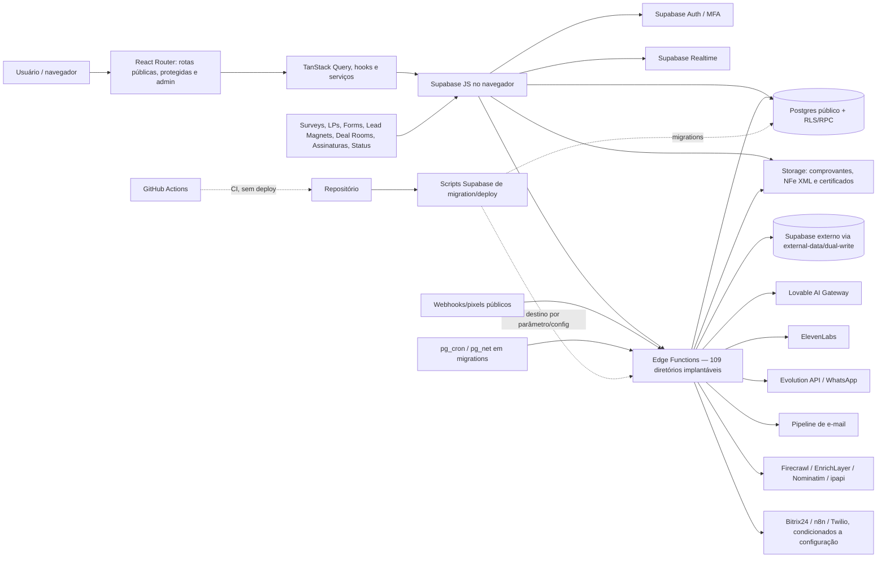

# Auditoria técnica total — SINGU CRM

Data da coleta: 2026-08-31 (America/Sao_Paulo)  
Repositório auditado: `adm01-debug/Singu_V2`, `main` em `740d1c4e`  
Banco canônico informado: Supabase `pgxfvjmuubtbowutlide`

## 1. Estado geral

O SINGU é um CRM React/Vite com autenticação, Postgres, Storage, Realtime e 109 Edge Functions Supabase, além de um proxy para outro banco Supabase e integrações de IA, voz, WhatsApp, e-mail e enriquecimento.  
A saúde de produção não pôde ser certificada: não há deployment registrado no GitHub e o acesso de Management API ao banco canônico respondeu `401 Unauthorized`.  
A `main` atual não tem proteção efetiva de CI: o workflow falha antes de criar qualquer job.  
O maior risco condicionado é `migrate-helper`: código versionado com chave estática pode devolver `service_role` e URL de banco se for implantado.  
O script oficial de deploy inclui essa função e publica todas as funções com JWT desabilitado.  
O projeto Supabase versionado (`hjh…`) diverge do canônico/linked (`pgxf…`), permitindo aplicar comandos no ambiente errado.  
O fluxo MFA de administradores entra em beco sem saída na própria tela de segurança.  
O ciclo de vida PWA documentado no código não corresponde à configuração gerada e não incorpora o handler de Web Push.  
Conclusões históricas dos documentos foram usadas somente como pistas: elas auditam projetos distintos e se contradizem em inventários, testes e estado operacional.  
Há uma falha P0 confirmada em runtime: `external-data` aceita JWT forjado como `service_role` e usa esse estado para acessar o banco externo sem escopo de tenant.

## 2. Contexto e escopo observado

- Sistema: CRM de inteligência relacional e comercial, com contatos, empresas, interações, pipeline, automações, marketing, IA e administração.
- Stack instalada pelo lockfile: React `18.3.1`, React DOM `18.3.1`, Vite `5.4.21`, TypeScript `5.9.3`, Supabase JS `2.112.2`, TanStack Query `5.101.4`, Zustand `5.0.14`, Zod `3.25.76`, Vitest `3.2.7` e Playwright `1.62.1`.
- Acessos efetivos: código e histórico Git completos; metadados e runs do GitHub; endpoint HTTP e Storage do Supabase canônico; sem consulta SQL, logs ou inventário de deploy do Supabase por falha de autorização.
- Restrições: missão somente leitura; as únicas escritas são este arquivo e `PLANO_100.md`; `node_modules` não está instalado; nenhum deploy ou mutação externa foi executado.
- Fluxos críticos deduzidos: login/MFA; cadastro e consulta de empresas/contatos; pipeline de negócios; campanhas/sequências; webhooks e mensageria.

## 3. Mapa de conexões



Entradas observadas no código:

- públicas de UI: `/auth`, `/survey/:token`, `/lp/:slug`, `/f/:slug`, `/lm/:slug`, `/dr/:token`, `/signature/:token`, `/status`, `/design-system`, `/reset-password` e `/sso/callback` (`src/app/AppRoutes.tsx:60-71`);
- protegidas: rotas de CRM/automação envolvidas por `RequireAuth` e `MFAGuard` (`src/app/AppRoutes.tsx:31-37,72-154`);
- administrativas: `RequireAuth` + `MFAGuard` + `RequireAdminLazy` (`src/app/AppRoutes.tsx:39-47,156-178`);
- servidor: 109 diretórios implantáveis em `supabase/functions/`, além de chamadas por cron HTTP presentes nas migrations;
- Storage confirmado no canônico: buckets privados `comprovantes-financeiro`, `nfe-xml` e `nfe-certificados`.

## 4. Achados

### Infra, deploy e configuração

#### A-001 · [P1] · segurança/backend — `migrate-helper` pode devolver credenciais administrativas

Evidência: `supabase/functions/migrate-helper/index.ts:5-29` contém uma chave de acesso estática (mascarada neste relatório), aceita CORS `*` e, em `action=credentials`, devolve `SUPABASE_SERVICE_ROLE_KEY` e `SUPABASE_DB_URL`; `supabase/config.toml:3-4` desabilita JWT. `scripts/migration/functions/deploy-all.sh:43-47,66-78` inclui todo diretório exceto `_shared`/`tests` e usa `--no-verify-jwt`. A chamada read-only ao endpoint canônico `migrate-helper` respondeu `404`, portanto o vetor não está ativo nesse projeto no momento da coleta. O commit `740d1c4e` reintroduziu esses dois arquivos depois da remoção de segurança registrada em `23116124`.  
Impacto: um deploy genérico ou manual dessa função transforma leitura do repositório em acesso de administrador ao banco e bypass integral de RLS.  
Como explorar: alguém com leitura do repositório copia a chave estática para `x-access-key` e chama `GET /migrate-helper?action=credentials` depois que a função for implantada.  
Causa raiz: uma ferramenta temporária de migração foi versionada na `main`, com segredo e resposta privilegiada no próprio código, sem exclusão no mecanismo de deploy.

#### A-002 · [P1] · infra — CI da `main` falha antes de criar jobs

Evidência: o run GitHub Actions `33181997921`, no commit auditado `740d1c4e`, terminou como `failure`, duração efetiva zero e sem jobs; `gh run view` reportou provável erro no arquivo de workflow. `.github/workflows/ci.yml:35,84,97` usa `secrets.PGHOST` diretamente em expressões `if`. A série de runs passou de execução real (70 s no commit `7b1df5d9`) para zero job após o commit `6017c921`, que introduziu esse padrão.  
Impacto: pushes e pull requests podem entrar na `main` sem instalar dependências, typecheck, lint, audit, testes, matriz RLS, build ou limite de bundle.  
Causa raiz: expressão de workflow inválida no nível de step impede o GitHub Actions de materializar o único job.

#### A-003 · [P1] · infra/backend — deploy em massa desabilita JWT para todas as Edge Functions

Evidência: `scripts/migration/functions/deploy-all.sh:43-47` descobre automaticamente todos os diretórios de função e `:75-78` chama `supabase functions deploy` com `--no-verify-jwt` sem allowlist ou classificação pública/privada. O mesmo script não invoca `scripts/migration/functions/secrets-leak-scan.sh`, apesar de o scanner existir.  
Impacto: uma função que dependa da validação de gateway, ou cuja autenticação interna seja incompleta, fica publicamente alcançável após o procedimento documentado de deploy.  
Como explorar: após `deploy-all.sh`, um atacante chama diretamente qualquer função cujo handler não rejeite token ausente, porque o gateway foi publicado sem `verify_jwt`.  
Causa raiz: conveniência de migração foi aplicada uniformemente a funções públicas, autenticadas, administrativas e de cron, sem manifesto de exposição por função.

#### A-004 · [P1] · configuração — referência Supabase versionada diverge do banco canônico

Evidência: `supabase/config.toml:1` fixa `hjhthvzwtvwgdrochcam`; `vite.config.ts:19` permite conexões ao canônico `pgxfvjmuubtbowutlide`; `supabase/.temp/linked-project.json`, lido por parse de JSON sem reproduzir credenciais, também informa `pgxfvjmuubtbowutlide`. A migration `supabase/migrations/20260512105729_ef6418c0-874e-4693-984f-b720410c6c2c.sql:10` ainda agenda `smart-notify` no host antigo `hjh…`.  
Impacto: link, deploy e cron podem mirar projetos diferentes; uma correção pode não atingir produção ou uma automação pode chamar um ambiente legado.  
Causa raiz: identidade de ambiente está duplicada em configuração, artefato local e SQL versionado, sem validação única contra o projeto canônico.

#### A-005 · [P1] · infra — pipeline não contém deploy versionado nem prova de produção

Evidência: `.github/workflows/ci.yml:9-113` termina em build/Lighthouse e não possui etapa de deploy; `.github/workflows/monitoring-lint.yml:15-49` apenas valida arquivos; a API do GitHub retornou zero deployments para o repositório.  
Impacto: não há trilha reprodutível que ligue um commit da `main` ao frontend ou às Edge Functions em produção; rollback e auditoria de versão ficam manuais.  
Causa raiz: o repositório automatiza verificações (atualmente quebradas), mas não declara promoção, destino, aprovação ou rollback de release.

### Frontend e UX

#### A-006 · [P1] · frontend/UX — MFA de administrador bloqueia a própria tela de habilitação

Evidência: `src/hooks/useMFAGuard.ts:30-40` marca AAL1 como não verificado e evita redirecionar apenas quando já está em `/seguranca`; `src/components/auth/MFAGuard.tsx:11-15` renderiza `null` sempre que MFA é exigido; `src/app/AppRoutes.tsx:31-37,154` envolve `/seguranca` no mesmo guard.  
Impacto: um administrador autenticado em AAL1 chega a `/seguranca`, mas recebe tela vazia em vez do fluxo para configurar/verificar MFA; todas as demais rotas protegidas continuam bloqueadas.  
Causa raiz: o destino de recuperação está dentro do componente que suprime toda renderização até a própria recuperação ocorrer.

#### A-007 · [P1] · PWA — contrato de atualização/Web Push não é gerado pela configuração real

Evidência: `src/main.tsx:16-26` exige `registerType: "prompt"` e estratégia `injectManifest` com `src/sw.ts`; `vite.config.ts:25-66` configura `registerType: "autoUpdate"` e `workbox`/`generateSW`, sem `injectManifest`; não existe `src/sw.ts`, enquanto o handler de push permanece isolado em `public/sw-push.js`. `src/main.tsx:103-123` espera `onNeedRefresh`, comportamento incompatível com atualização automática declarada.  
Impacto: o banner de atualização pode não controlar a ativação como prometido e o service worker gerado não incorpora os listeners de push, deixando notificações Web Push sem handler no SW que controla o escopo.  
Causa raiz: implementação e comentários foram migrados para uma arquitetura de service worker único, mas a configuração e o arquivo-fonte exigido pela estratégia não acompanharam a mudança.

#### A-008 · [P1] · observabilidade/frontend — relator de erros usa variável inexistente e descarta falhas

Evidência: o cliente principal usa `VITE_SUPABASE_PUBLISHABLE_KEY` em `src/integrations/supabase/client.ts:6-12` e `.env.example:1-3`; o relator usa `VITE_SUPABASE_ANON_KEY` em `src/lib/errorReporting.ts:113-115,199-201`. Sem essa variável, o flush retorna silenciosamente; mesmo quando configurada, `:133-146` não verifica `response.ok` e descarta erro/rejeição.  
Impacto: erros reais de produção podem nunca chegar a `error_logs`, fazendo painéis e resposta a incidentes operarem sem a telemetria que o frontend afirma produzir.  
Causa raiz: dois nomes de contrato para a mesma chave pública e uma política deliberada de falha silenciosa no próprio canal de observabilidade.

### Backend e integrações

#### A-013 · [P0] · segurança/backend — JWT forjado assume `service_role` na função `external-data` implantada

Evidência: `supabase/functions/_shared/auth.ts:227-260` apenas decodifica o payload do Bearer token e retorna o sentinela `__SERVICE_ROLE__` quando encontra `role: "service_role"`; não verifica assinatura, emissor, audiência, expiração nem compara o token à chave do ambiente. `supabase/functions/external-data/index.ts:201-209` aceita esse resultado e dispensa rate limit; `:389-447` executa `SELECT` com a chave `EXTERNAL_SUPABASE_SERVICE_ROLE_KEY` sem adicionar `user_id`; `:225-299` também expõe introspecção de host/schema a esse chamador. A sondagem do Supabase canônico retornou `status=200` para `external-data`. Em seguida, um POST controlado com JWT de assinatura falsa e tabela propositalmente inválida — sem consultar qualquer dado — retornou HTTP `400` com headers produzidos pela Edge Function, provando que atravessou o gateway e o helper; um token inválido deveria ter parado em `401`. `send-push-notification`, também implantada (`status=200`), consome o mesmo helper em `supabase/functions/send-push-notification/index.ts:72-119`.  
Impacto: qualquer pessoa na internet pode se apresentar como service role, consultar tabelas permitidas do banco externo sem isolamento por usuário e, pela segunda função implantada, escolher o `userId` alvo de uma tentativa de push. É uma quebra ativa de autenticação com dados em risco.  
Como explorar: construir qualquer JWT de três segmentos cujo payload seja `{"role":"service_role"}` e enviá-lo como Bearer permite chegar ao caminho privilegiado de `external-data`, onde um `select` em tabela permitida usa service role e não filtra `user_id`.  
Causa raiz: autorização privilegiada é decidida por conteúdo não autenticado do JWT antes da única rotina que realmente consulta `auth.getUser()`.

#### A-014 · [P1] · segurança/backend — proxy externo permite mass assignment de `user_id` em updates

Evidência: `supabase/functions/external-data/index.ts:464-478` recebe `updates` como objeto arbitrário e o envia integralmente ao banco externo. Para usuário comum, a cláusula `.eq('user_id', userId)` restringe qual linha começa sendo alterada, mas não remove `user_id`, `owner_id`, `role` ou outros campos sensíveis do payload; `update_with_version` repete o padrão em `:481-505`.  
Impacto: mesmo após corrigir o bypass P0, um usuário autenticado pode transferir uma linha própria para outro `user_id` ou alterar campos privilegiados existentes nas tabelas da allowlist; o conjunto exato de colunas afetadas depende do schema externo, que não pôde ser introspectado.  
Como explorar: enviar `action=update`, o ID de uma linha própria e `updates.user_id` com outro UUID satisfaz o filtro de dono pré-update, mas grava o novo proprietário porque o payload não é saneado.  
Causa raiz: o proxy protege o predicado de seleção, porém trata todos os campos mutáveis como equivalentes e não possui allowlist por tabela/operação.

#### A-009 · [P1] · segurança/integrações — assinatura HMAC de webhook é opcional por registro

Evidência: `supabase/functions/incoming-webhook/index.ts:69-72,92-104` aceita token no path/header e carrega o registro com service role; a assinatura e proteção anti-replay só executam dentro de `if (webhook.require_signature)` em `:113-144`; em seguida, `:205-223` insere payload mapeado em `contacts`, `companies`, `deals`, `interactions` ou `notes` como o dono do webhook.  
Impacto: qualquer webhook ativo criado/configurado com `require_signature=false` autoriza escrita de dados de negócio apenas com conhecimento ou vazamento do token estático. A existência desse estado no banco canônico não pôde ser consultada.  
Como explorar: obtendo o token de um webhook sem `require_signature`, o atacante envia um JSON arbitrário ao endpoint e a função o grava com `service_role` sob `created_by`.  
Causa raiz: autenticidade forte é uma opção de dados, não uma invariável do endpoint que executa escrita privilegiada.

#### A-010 · [P1] · segurança/integrações — pixel de intenção permite forjar sinais e atribuir e-mail sem prova de origem

Evidência: `supabase/functions/intent-tracker/index.ts:26-35` aceita `pixel_key`, tipo, URL, e-mail e metadata; `:68-79` valida apenas que a chave pública do pixel está ativa; `:81-109` resolve um contato pelo e-mail informado e insere o sinal com `service_role`, sem assinatura, Origin/Referer vinculados ao domínio ou nonce.  
Impacto: quem obtiver uma chave de pixel exposta por natureza no site pode inflar intenção, associar atividade forjada a contatos conhecidos e contaminar lead scoring/automação.  
Como explorar: copiar o `pixel_key` do site e postar repetidamente `pricing_view`/`demo_request` com o e-mail de um contato cria sinais de alto peso para esse usuário.  
Causa raiz: uma credencial pública de coleta é tratada como prova de autenticidade do evento e do endereço de e-mail declarado.

#### A-011 · [P2] · observabilidade/backend — health check converte falha interna em zero alertas

Evidência: `supabase/functions/system-health/index.ts:117-130` captura qualquer falha ao consultar `alerts` e retorna `0`; `:166-172` publica esse número sem estado de erro.  
Impacto: indisponibilidade ou drift da tabela/policy pode ser exibido ao operador como “nenhum alerta”, reduzindo a capacidade de detectar incidente.  
Causa raiz: erro de medição e valor saudável compartilham a mesma representação numérica.

#### A-012 · [P1] · frontend/observabilidade — página pública de status fica verde quando não há resposta

Evidência: `/status` é pública em `src/app/AppRoutes.tsx:68`; `src/pages/StatusPage.tsx:56-66` faz a chamada e pode entrar em estado de erro, mas não lê `isError`/`error`; `:68-69` define ausência de `data` como `healthy` e `:81-96` mostra “Todos os sistemas operacionais” depois do loading. A Edge Function `system-health` exige `withAuth` em `supabase/functions/system-health/index.ts:133-143`, apesar de a rota ser anunciada como pública.  
Impacto: visitante sem sessão ou durante falha do endpoint recebe sinal verde justamente quando o estado real é desconhecido.  
Causa raiz: o fallback visual transforma ausência/erro em sucesso, e o contrato de autenticação da página diverge do handler.

## 5. Não verificado

Esta seção será consolidada ao final. Já permanecem não verificados:

- schema, RLS, grants, índices, órfãos, dados, crons, migrations aplicadas, logs e funções implantadas no Supabase canônico: ferramentas de Management API responderam `401 Unauthorized`;
- versão/deployment/URL do frontend e tráfego real: o GitHub não possui deployment registrado e não foi fornecido provedor/URL;
- existência de webhooks com `require_signature=false`, secrets configurados e serviços externos ativos: dependem do estado remoto;
- build, typecheck, lint, unitários e E2E atuais: `node_modules` ausente e instalar dependências criaria artefatos fora das duas escritas autorizadas;
- restauração de backup, PITR, RTO/RPO e stack Prometheus/Alertmanager: há documentos declaratórios, mas não acesso à infraestrutura nem evidência remota nesta sessão.

## 6. Reprodutibilidade

Lista preliminar; comandos adicionais serão incorporados ao fechamento:

```bash
git status --short --branch
git rev-parse HEAD main origin/main
git log --oneline --all -- supabase/functions/migrate-helper supabase/config.toml
git show --stat --oneline 740d1c4e
rg --files README.md docs
wc -l README.md docs/**/*.md docs/*.md
find src supabase/functions supabase/migrations tests e2e scripts -type f
rg -n "import\.meta\.env|Deno\.env\.get" src supabase/functions
rg -n "functions\.invoke|cron\.schedule|https?://" src supabase/functions supabase/migrations
nl -ba .github/workflows/ci.yml
gh run view 33181997921
gh api repos/adm01-debug/Singu_V2/deployments
nl -ba supabase/config.toml
nl -ba supabase/functions/migrate-helper/index.ts
nl -ba scripts/migration/functions/deploy-all.sh
nl -ba src/app/AppRoutes.tsx
nl -ba src/hooks/useMFAGuard.ts
nl -ba src/components/auth/MFAGuard.tsx
nl -ba vite.config.ts
nl -ba src/main.tsx
nl -ba src/lib/errorReporting.ts
nl -ba supabase/functions/incoming-webhook/index.ts
nl -ba supabase/functions/intent-tracker/index.ts
nl -ba supabase/functions/system-health/index.ts
nl -ba src/pages/StatusPage.tsx
```

Consultas read-only realizadas pela conexão Supabase: overview, health, estatísticas, migrations, tabelas, policies, funções, triggers, views, enums, relacionamentos e contagens; todas falharam com `Management API 401: Unauthorized`. A listagem de Storage foi a única introspecção remota bem-sucedida. O endpoint canônico `migrate-helper` foi consultado sem credencial e respondeu `404`; nenhuma ação `credentials` foi chamada.
